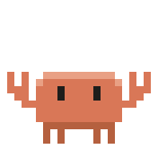
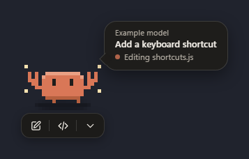
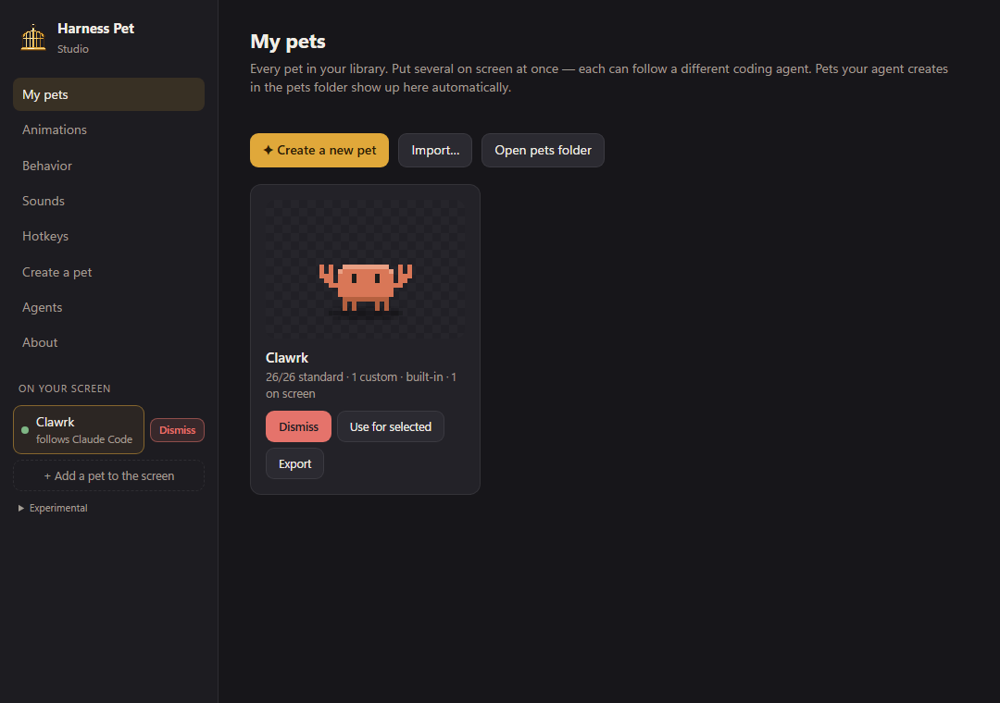
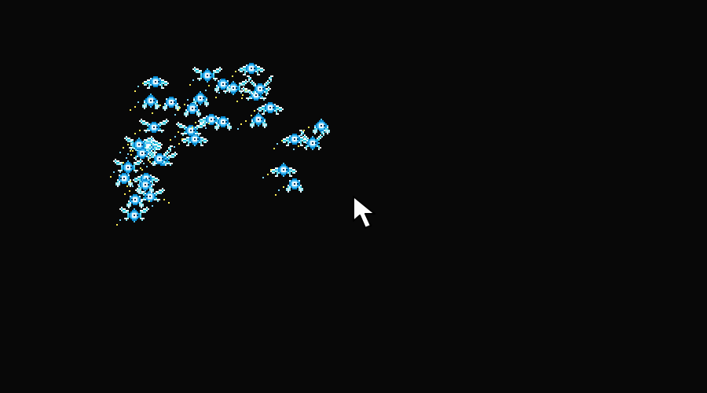

<p align="center"></p>

# Harness Pet

Desktop pets that keep an eye on your coding agents. A pet sits on your screen, acts out what your agent is doing (thinking, working, waiting for you, done) and jumps you back into the right app with one click. It ships with **Clawrk**, a pixel crab. You can create your own pets with any coding agent, share them as single files, and run several at once, each following a different agent.

**Windows 10/11 x64 · pre-beta, run from source · preparing `0.1.0-beta.1`.** It's free and open source (MIT), with no telemetry. Electron blocks external network requests; configured buttons can open other applications or websites through Windows. Worried about the keyboard watcher? Don't take our word for it: [verify it yourself](#verify-it-yourself).

> [!IMPORTANT]
> **Pre-beta: try it from source, no installer yet.** You can [run Harness Pet from source](#run-from-source) today in a few minutes. So far it has been tested on one machine: the maintainer's Windows 11 PC, where it has run daily for several days alongside real Claude Code sessions. It hasn't yet been tested on other PCs, display setups, Windows 10 or agents other than Claude Code, so expect rough edges and please [open an issue](https://github.com/muncheslunches/harness-pet/issues) when you hit one. A downloadable installer will appear on [Releases](https://github.com/muncheslunches/harness-pet/releases) once clean-machine and upgrade/uninstall checks pass. See [CHANGELOG.md](CHANGELOG.md) for known open items.







The screenshots use the current app with an isolated profile and sample session data.

## Highlights

- **Reacts to your agent.** Claude Code connects in one click. Antigravity, Cursor, Codex, Gemini CLI, Copilot CLI, Windsurf, Cline and anything else connect with a ready-made prompt your agent follows.
- **A real speech bubble.** It shows the model ("Claude Opus 5.5") and the task. The tail always points at the pet. It turns into a thought bubble while the agent thinks, and a gold "shout" when the agent needs you. Drag it anywhere around the pet and it stays there. If that spot would go off-screen, it slides back into view and returns once there's room.
- **ChatGPT-pet-style bar.** Minimize the bubble to a bell with a running count, which then collapses into a small pill.
- **A proper pet menu (middle-click the pet):** jump, sessions, put to sleep (until you click or move it), disable for a while, animations, behavior, size, bubble, sounds, which agent to follow, buttons, always-on-top, click-through, and bring back on screen.
- **Sounds.** A catalog of 25 tiny synthesized sounds, tied to animations. Each pet has its own mute and volume, and each animation gets its own sound, on/off switch and volume. Pets can ship their own sounds too.
- **Hotkeys.** System-wide shortcuts to show or hide pets, jump to the agent, press either button, open the Studio, mute, or put everything to sleep. Rebind them by pressing the keys; you're warned if another app already owns a combo.
- **A crab that acts like a crab:** it wanders sideways, blows bubbles, digs and peeks out, dances, juggles, sneezes, naps in a nightcap, panics when picked up, giggles when double-clicked, and puffs up or squeezes when resized.
- **Pets meet each other.** Walk into another pet and you get rejected, dizzy, while the other shoos you off. Drop one on another and it gets shoved aside. Idle neighbours wave.
- **You decide how much it moves:** anchor it to its bar on a short leash, keep it on one screen, any screen or the taskbar, make it shy or clingy, let it fall when dropped, set its speed, or turn on calm mode.
- **Gets out of your way** (optional, you're asked on first run). Standing on text while you type, a pet huffs and walks to a bare spot until you stop. With Caps Lock on, type `GO AWAY`, `GET OUT` or `MOVE` and every pet near text moves off it and stays put for 30 seconds to 5 minutes, or until you click it. See [Getting out of the way](#getting-out-of-the-way-of-text).
- **Any size.** Ctrl + mouse wheel over the pet resizes it from 50% to 300%, with a little mouse-wheel indicator. Bigger pets move slightly slower.
- **Studio:** a library with live previews, an animation tester with per-animation toggles and sliders, behavior settings, a pet-creation prompt maker, and agent setup.
- **Modular pets.** A pet is one `.pet.js` file. Missing standard animations get stand-ins plus an **Include this** button that copies a prompt to add them. Custom animations (a bird that zooms across the screen at high speed, say) are detected automatically, with their own toggles and sliders.
- **Pets run sandboxed, with no network, files or Node:** it can only draw and suggest movement.

## Run it

### Run from source

This is the way to try Harness Pet during the pre-beta. You need:

- Windows 10 or 11, 64-bit
- [Node.js 22](https://nodejs.org/) (CI uses 22.23.3)
- [Git](https://git-scm.com/download/win)

Pick a folder you'll keep, then run:

```powershell
git clone https://github.com/muncheslunches/harness-pet.git
cd harness-pet
npm install
npm start
```

Clawrk appears on your screen, and a cage icon appears in the system tray. Click the cage to open the **Studio**. To start it again later, run `npm start` from the same folder.

To link it to Claude Code, open **Agents → Claude Code** in the Studio and press **Connect**, or run `npm run hooks:claude`. Start a new Claude Code session afterwards. Connect adds a few hooks to `~/.claude/settings.json` and keeps your existing hooks and settings.

> [!WARNING]
> Connected hooks run from this folder. **Press Disconnect in the Studio before you move or delete it**, or Claude Code will report hook errors. Pre-beta builds can change without notice: run `git pull` and `npm install` to update, then press Connect again.

#### Or let your coding agent set it up

Paste this into Claude Code, Codex, Cursor or a similar agent:

> Clone https://github.com/muncheslunches/harness-pet into a folder I'll keep. Check that I have Windows 10/11 x64, Git and Node.js 22, and tell me if anything is missing instead of installing it. Then run `npm install` and `npm start`. Don't connect any agent hooks until I ask. Afterwards, tell me how to open the Studio and how to disconnect before removing the folder.

Read [Privacy](#privacy) first if you want to know what the app sees. [Verify it yourself](#verify-it-yourself) shows how to check.

### Install a local Windows build

No official installer has been published yet. Once you build one as described
below, run `dist/Harness-Pet-Setup-<version>-x64.exe` and open **Harness Pet**
from the Start menu or desktop shortcut. The installer includes Electron and a
private Node.js runtime for agent hooks and pet validation, so the installed app
doesn't need Node.js or a terminal. Self-built installers are unsigned and
untested release candidates; see [Windows signing](docs/WINDOWS_SIGNING.md).

### Build a Windows installer

On Windows x64 with Node.js installed (including its adjacent `LICENSE` file):

```powershell
npm install
npm run dist:win
```

The distributable installer is written to `dist/`. Share the setup `.exe`;
`dist/win-unpacked` is the complete unpacked app for inspection and requires
all its accompanying files. The build never publishes or launches the app.
Keep the installed app in place so configured agent hooks keep working.

## Using the pet

| Do this | And |
|---|---|
| Click the pet | Wake it if asleep, or call it back if it moved out of your way. Leaves the current app in focus. |
| Click its bubble | Jump to the session it's showing (the exact Claude Code session in Claude Desktop). |
| Drag the bubble | Re-anchor it anywhere around the pet; "Speech bubble → Put it back in its default spot" undoes this |
| Double-click | It giggles |
| Drag | It panics, then lands with a puff of dust |
| Ctrl + wheel | Resize it |
| Bar buttons | Two configurable buttons (for Claude: new chat and new Code session), plus ⌄ to minimize |
| Middle-click | The full menu: sleep, disable, animations, behavior, size, bubble, sounds, follows, buttons, window, hotkeys, Studio |
| Right-click | Shoos it: the pet huffs and scampers away from the cursor (or wakes up if asleep) |
| Ctrl+Alt+P / J / N / K / H / M | Show/hide pets, jump, first button, second button, Studio, mute (rebind in Studio → Hotkeys) |

## Getting out of the way of text

Windows only. Two things make a pet step off your text:

- **Typing.** While you type, a pet standing on text (or on the line you are about to fill, when the app reports its caret) walks to the nearest bare spot, avoiding other pets and, where it can, crossing text on the way. It waits there until you've stopped typing for a few seconds. Turn it off per pet with **Behavior → Dodge my typing**.
- **Capital-letter commands.** Turn Caps Lock on and type `GO AWAY`, `GET OUT` or `MOVE` (a whole word, then pause or press Space/Enter). Every pet near text goes to a bare spot and stays for 30 seconds to 5 minutes. A left or right click on the pet sends it back to normal at once. Calm and anchored pets don't move.

How it works and what it sees: a small PowerShell process (`native/key-watch.ps1`) watches the keyboard. It reports *that* you pressed a key, never which one, except while Caps Lock is on, when it forwards key codes so the command can be recognised; only a short rolling buffer of capital letters is kept, in memory, and cleared on anything else. When a pet might be in the way, the app takes a screenshot with the pets hidden from it, looks for text-like texture (sharp strokes in both directions, so it works in any app and theme) and throws the screenshot away. Nothing is stored or sent anywhere. It's **off until you say yes**: the app asks once on first run, and you can switch it on or off any time with the tray item **Watch typing (dodge text, "GO AWAY")**.

Detection is by texture, not by reading, so busy photos and patterned wallpaper can look like text, and very faint text may be missed. `npx electron scripts/smoke-scan.js` checks capture on your machine; `npx electron scripts/e2e-avoid.js [phrase|typing]` runs the whole thing against a scratch copy of the app (it needs a moment of keyboard focus and types into its own test window).

## Make your own pet

For flying pets (a fairy, a bird, a drone), turn on **Clingy** and choose **Cursor following → All directions** in the pet's Behavior settings (Studio or its menu). Each pet has its own setting; existing pets default to **Sideways**. Leave **Wander around** on and **Anchor to its bar** off. The pet steers toward the cursor, slows down nearby, and keeps a small gap. **Taskbar** still restricts movement to sideways. Turn **Shy** off if you don't want it to flee when the cursor gets close. Settings apply immediately once this version of the app is running.

**Middle-click a desktop pet** to open its settings menu; right-click still shoos it. In Behavior, **Bubble → Off** hides the bubble and button bar. Setting both labeled button slots to Off automatically minimizes the bubble and disables Shown until a button is enabled. After three consecutive collisions with the same neighbour, the pet waits ten seconds before moving again.

Turn on **Behavior → Pass through other pets** for a pet that can move through its neighbours without bumping or blocking them. It stays clickable and draggable. Only one pet settings menu opens at a time; Escape or clicking elsewhere dismisses it.

Local crash and helper errors are recorded in `~/.harness-pet/app.log`. A crashed pet renderer automatically reloads up to twice per minute, resetting its mouse capture so it cannot block the desktop.

Pet button presses, menu requests, and input-delivery failures are also logged there automatically. Putting a pet to sleep stops travel and plays its sleep animation at 10% speed; waking it plays its wake animation when available.

If a pet gets stuck, **Ctrl + double-click** it or choose **Refresh this pet** from its menu (also available through Studio). Refresh recreates its window and worker while keeping its position and settings. If clicking the pet is unavailable, choose **Refresh all pets** from the tray. A regular double-click still plays its friendly reaction.

In **Sounds → Add custom sounds**, describe sounds separated by commas and copy the prompt for the selected pet. Its custom sound recipes appear above Agent status with their own preview, volume and enable switch. Hotkey status badges are buttons: switch an action off without clearing its shortcut. The **Experimental** dropdown under Add a pet duplicates the selected pet, or dismisses all experimental duplicates while preserving original pets.

In the Studio, open **Create a pet**, describe it (a "round blue bird with a yellow beak", a "grumpy toaster"…), add any special animations, and press **Generate prompt**. Paste the prompt into your coding agent; we suggest Claude Opus 5.5. The agent writes `<name>.pet.js` into your pets folder (`pets/` in the project when you run from source, `~/.harness-pet/pets/` when installed; the prompt includes the exact path), checks it with the validator, and the pet appears in **My pets** on its own. Imports also go there; exports open a save dialog so you can choose a folder.

The format is documented in [docs/PET_FORMAT.md](docs/PET_FORMAT.md). To check a pet by hand:

```bash
npm run validate -- path/to/pet.pet.js
```

**Sharing:** use **Export** in My pets, and **Import…** for pets other people send you.

## Connect other agents

Each agent needs two things: hooks that call the bridge (`hook/harness-pet-hook.js`), and a *link* in `~/.harness-pet/links.json` that tells the two buttons what to open. In **Studio → Agents**, every listed harness has a **Copy setup prompt** button that walks your agent through both. **Any other agent** gives a universal prompt where the agent works out its own harness. The bridge maps event names from all of these onto pet states, and it never blocks or changes what the agent does.

## Known limitations

- **Windows 10/11 x64 only.** The installer build checks for a Windows x64 build host. macOS, Linux and Windows ARM64 builds are not supported by this release setup.
- **Agent integrations are still being tested.** Claude Code has an automatic Connect/Disconnect flow. Other agents need the setup prompt and may need manual hook configuration. Automated bridge tests exercise Claude Code, Antigravity, Cursor and Codex event payloads; these tests do not establish that every integration works in a live agent. Live end-to-end agent coverage has not yet been recorded for the beta candidate. Gemini CLI, Copilot CLI, Windsurf and Cline are offered as setup guides without dedicated live verification here.
- **Keep the app at the path used during hook setup.** Moving or deleting it can leave stale paths in agent settings. Disconnect before moving, then reconnect from the new location. For other agents, update their hook commands manually. Quiet handling of missing Claude Code hook files is still an open release blocker; do not rely on it yet.
- **Text avoidance is approximate and opt-in.** It detects texture rather than reading text, so patterned backgrounds can cause false positives and faint text can be missed. Display scaling and multiple monitors need more live testing.

## Uninstall

1. While the app is still installed, open **Studio → Agents → Claude Code → Disconnect**. This removes Harness Pet's recognized hooks from `~/.claude/settings.json`, preserves other hooks/settings, and writes a timestamped settings backup. If running from source, `npm run hooks:claude:remove` does the same.
2. For each other agent you configured, remove its Harness Pet hook commands in that agent's settings. The app does not disconnect those automatically.
3. Quit Harness Pet from its tray menu. For an installed copy, remove it through **Windows Settings → Apps**. The NSIS uninstaller also attempts to remove this copy's Claude Code hooks before deleting files; that path still needs an installer/uninstaller smoke test. Disconnecting first is the recommended procedure. For a source checkout, disconnect before moving or deleting the project folder.
4. Optionally delete `%USERPROFILE%\.harness-pet` after the app and hooked agents are closed. This permanently removes preferences, links, local session state, logs and any pets stored there. Export pets you want to keep first. Source-checkout pets live in the project's `pets/` folder and are separate. Settings backups under `%USERPROFILE%\.claude\settings.json.pet-backup-*` remain unless you remove them yourself; they may contain old hook commands.

## Privacy

- **Electron network restrictions.** The app blocks external HTTP/WebSocket requests and unauthorized local files. Pet code runs in a worker with network APIs removed and no Node access. Trusted button configuration in `links.json` can launch local commands, application URL schemes or websites through Windows. Those external programs have their own permissions and network access. Review agent-generated links before using them; imported pet manifests do not supply button actions. Command arguments are passed directly without a shell; an explicitly configured shell executable can still run commands.
- **No telemetry.** Nothing about you or your use is collected or sent anywhere.
- **The keyboard watcher is opt-in.** When it's on, it only learns *that* you typed, except for capital letters while Caps Lock is on (so it can hear `GO AWAY`). Those are kept in a short buffer in memory and cleared on anything else. See [Getting out of the way](#getting-out-of-the-way-of-text).
- **Screenshots never leave memory.** They're taken only to find text under a pet, with the pets hidden, and thrown away right after.
- **Agent hooks write local status files** to `~/.harness-pet/sessions/`: session identifiers, state and timestamps, the project folder/path, model name, a shortened first non-empty line of your prompt (up to 48 characters), and brief tool details such as a filename or command description. A record may also include a local transcript path so a lost Stop event can be checked. Some integrations read local agent transcripts to recover a title/model or completion state. The hooks do not send this information over the network. Treat the files as private: even shortened prompts, paths and tool descriptions can contain sensitive information.

- **Logs stay local** in `~/.harness-pet/app.log`.
- **Diagnostic logging is opt-in.** With `HARNESS_PET_DIAG=1`, mouse/input timing and window/IPC diagnostics go to `~/.harness-pet/diag.log`. Review and redact logs before sharing them. See [CONTRIBUTING.md](CONTRIBUTING.md#reporting-bugs-and-diagnostics) for enabling it.

Pet animation code receives only the agent's status (`idle`, `thinking`, `working`, `needs-you`, or `done`), not prompt snippets, tool details, transcript paths/content, captured keys or screen images. The trusted app draws the session labels. Local `app.log` diagnostics can include installation paths, window/input metadata and errors; optional diagnostic flags add more detail. Review and redact logs, screenshots and exported evidence before sharing them.

The typing consent dialog includes the in-memory screen scan. Older profiles are asked again for this version of consent; the watcher stays off until a choice is made. Disabling Watch typing cancels queued scans, discards any capture already in flight and stops the keyboard helper. A completed screenshot is never sent to pet code or written to disk by this feature.

### Verify it yourself

A desktop app with a global keyboard hook and screenshots can look like a keylogger, so you're right to check. Harness Pet ships as plain, readable files (no ASAR archive, no minified bundle), so you can inspect the exact code you run:

- **Keyboard watcher:** [`native/key-watch.ps1`](native/key-watch.ps1) is the whole hook. It prints `t` ("a key was pressed", at most every 250 ms) and, only while Caps Lock is on, the key code. [`lib/key-watch.js`](lib/key-watch.js) is the only code that reads that output.
- **Network blocking and sandboxing:** [`lib/security.js`](lib/security.js), [`lib/ipc-policy.js`](lib/ipc-policy.js) and [`runtime/pet-worker.js`](runtime/pet-worker.js).

For an independent second opinion, use **[REA (Reverse Engineer Anything)](https://github.com/morluto/rea)**, a free, MIT-licensed, third-party tool that lets an AI coding agent (Claude Code, Codex, Cursor, Gemini CLI and others) analyze a program and show the evidence behind its answers. Harness Pet is not affiliated with REA. You need Node.js 22.19 or newer.

> [!WARNING]
> Install REA only from [github.com/morluto/rea](https://github.com/morluto/rea), [rea.tools](https://rea.tools/) or the [`rea-agents`](https://www.npmjs.com/package/rea-agents) npm package. Fake copies under similar names have shipped malware.

1. Connect REA to your coding agent:

   ```powershell
   npx rea-agents@latest setup
   ```

2. Ask your agent something like this, using the folder you want to check. For an installed copy, that's `%LOCALAPPDATA%\Programs\Harness Pet\resources\app` by default. For a source checkout, use the project folder.

   > Use REA to analyze the Electron app at `<folder>`. Does it send any data over the network? What does `native/key-watch.ps1` report to the app, and does anything store, log or transmit keystrokes or screenshots? Show me the evidence.

3. Or skip the agent and get REA's raw static report: modules, imports and Electron boundaries, each with its evidence:

   ```powershell
   npx -y rea-agents@latest analyze-javascript-application "$env:LOCALAPPDATA\Programs\Harness Pet\resources\app" --json
   ```

The `node.exe` and Electron executables in an install come from the official Node.js and Electron releases; the build only renames the Electron executable and sets its icon and version details. REA's JavaScript analysis covers Harness Pet's own code. Inspecting those binaries needs a native decompiler such as Ghidra. Found something that contradicts this section? Please [report it privately](SECURITY.md).

### Settings recovery

If preferences or links cannot be parsed or have an invalid structure, the app uses recovery defaults and shows a Studio warning. Reading damaged links does not replace them. Before a save replaces a damaged file, the app creates a byte-for-byte sibling named `prefs.json.recovery-<UUID>` or `links.json.recovery-<UUID>`. A failed backup blocks replacement. Unreadable originals block saving; temporary-write/rename failures leave the previous file intact. Changes made externally since the app loaded a file are also preserved; restart to reload them.

To restore, quit Harness Pet, make a separate copy of `%USERPROFILE%\.harness-pet`, and inspect the original and any `.recovery-*` files. Restore a known-good JSON file to `prefs.json` or `links.json`, then relaunch. Fix file permissions or free disk space before retrying a failed save. For a reset, rename just the affected JSON file to a retained backup while the app is closed; relaunch to use defaults. Keep the pets folder and export any pets you want to retain. Never replace the whole data directory just to repair one setting.

Pet files over 1 MB are rejected. A load that exceeds five seconds or an animation frame that stops responding for two seconds has its worker terminated, with at most one outstanding frame. Studio previews show the error; on-screen pets show a notice when possible. Open Studio from the tray to hide/remove the instance or select another pet; Refresh all pets retries fixed files. Removing an on-screen instance keeps its library file. Missing files fall back to Clawrk while preserving the original reference for repair. These limits do not guarantee protection from every resource-exhaustion attempt; repeated renderer crashes stop automatic recovery after two retries in a minute.
- **You control removal.** Session-end events remove their status record; stale records and logs may remain after interrupted sessions or uninstalling. Disconnect hooks before deleting local data as described in [Uninstall](#uninstall).

## Experimental features

These work, but they're rougher than the rest of the app and may change or disappear. Find them in the Studio sidebar under **Experimental**, below **Add a pet to the screen**.



- **Duplicate selected pet** puts another copy of the selected pet on screen. Each duplicate starts as a copy of the original, agent and settings included, and can then be changed on its own. Press it a few times for a swarm.
- **Dismiss all duplicates** removes every duplicate at once and leaves your original pets alone.
- **...cage...** adds an ornate cage to the screen. Drop pets into it to cage them: caged pets stay inside, move more slowly and ignore other pets. Untick it to release them.
- **Voice (experimental)**, one of the Claude Code buttons, opens a new Claude chat and then tries to press its voice or dictation button for you. It depends on the Claude app's layout, so it can miss.

> [!WARNING]
> **Go easy on the number of pets.** Every pet on screen, duplicates included, is its own window with its own sandboxed worker, so memory and CPU use grow with each one. A handful is fine. Dozens can make your PC sluggish, especially with animations and sounds on. If things slow down, press **Dismiss all duplicates**, or quit Harness Pet from the tray.

## Where things live

| Path | What |
|---|---|
| `pets/` inside the project (from source), or `~/.harness-pet/pets/` (installed) | Your pets and Clawrk (watched; changes reload live) |
| `~/.harness-pet/sessions/` | Session state written by hooks |
| `~/.harness-pet/links.json` | What the buttons open, per agent |
| `~/.harness-pet/prefs.json` | Pets on screen and their settings |

## Develop

```bash
npm test
```

See [CONTRIBUTING.md](CONTRIBUTING.md) for how to send changes.

| Folder | Holds |
|---|---|
| `main.js` | App, tray, menus and the Studio bridge |
| `lib/` | Pet host, storage, library, prompts, Windows helper, Claude Code hook installer and icon |
| `pet-window/` | The on-screen pet |
| `studio/` | The Studio |
| `runtime/` | The sandboxed pet worker |
| `shared/` | Animation catalog, pet schema and harness notes |
| `pets/clawrk.pet.js` | Clawrk |

## License

MIT. Clawrk is an original pixel crab created for this project. Harness Pet isn't affiliated with Anthropic, Google, OpenAI, Cursor or any other agent vendor; product names are used only to say what it works with.
